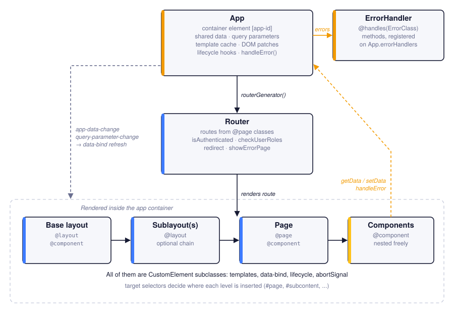
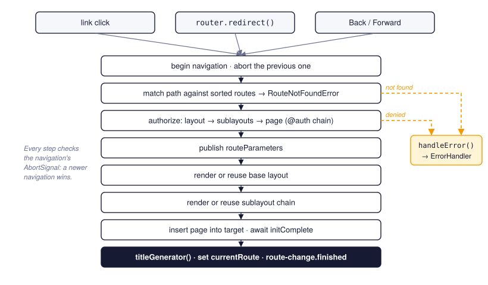

# Architecture

This page introduces the main building blocks, shows how they are wired together and follows an
application from startup to the first rendered page.

## The building blocks

| Part | Role |
| --- | --- |
| `App` | The application object. Owns the container element, shared data, query parameters, the template cache, lifecycle hooks and the error handlers. |
| `Router` | Maps URLs to pages, renders layouts and pages into the container, checks authentication and handles navigation. |
| `CustomElement` | Base class of every component, layout and page. Renders templates, binds events, manages its lifetime and lifecycle. |
| Layout | A `CustomElement` decorated with `@layout`: the frame into which pages are rendered. |
| Page | A `CustomElement` decorated with `@page`: the component a route renders. |
| `ErrorHandler` | A class whose `@handles(...)` methods deal with errors raised anywhere in the application. |
| Decorators | `@component`, `@page`, `@layout`, `@auth`, `@lifecycle`, `@handles`, `@react`, `@reactFactory`, `@queryParam`, `@select`, `@selectAll`. |
| `lazy()` | Declares dynamically imported dependencies of a component. |
| Vite plugin | Build-time discovery of `@page` classes, so the router does not need a list of pages. |

{ .diagram }

The **App** is created first. Its `routerGenerator()` method creates the **Router**, which
renders the route's **base layout**, any **sublayouts** and the **page** into the app's
container. Pages and layouts are ordinary components and can contain any number of further
**components**. All of them extend `CustomElement`.

Two kinds of communication flow back up:

- Components read and write shared state through the App (`getData`, `setData`,
  `updateQueryParameters`). The App answers with DOM events (`app-data-change`,
  `query-parameter-change`) that make components refresh the affected parts of their markup.
- Errors raised in components, the router or server-component requests are passed to
  `app.handleError()`, which offers them to the registered **ErrorHandler** classes.

## How components find the application

There is no global singleton and no dependency injection. When `app.init()` runs, the App stores
itself on the container element (`container.app`) and marks the container with an `app-id`
attribute. When a component initializes, it looks up its nearest ancestor with that attribute:

```typescript
const appContainer = this.closest("[app-id]");
this._app = appContainer.app;
```

From then on `this.app` is available in the component, typed as your own application class. A
component outside the app container cannot initialize; it fails with
*"Failed to detect application container"*.

## Startup sequence

What happens, in order, when `await app.init("#app")` runs:

1. **Resolve the container.** The argument can be a selector or an element. The App sets
   `container.app` and a random `app-id`.
2. **Start the template-cache cleanup timer** ([Template caching](template-caching.md)).
3. **Patch DOM prototypes** (once per page; see below).
4. **Instantiate the error handlers** listed in `errorHandlers`.
5. **Run `@lifecycle(BEFORE_INIT)` hooks** on the App, then **`EXTENSION_INIT` hooks**.
6. **Create the router** by calling `routerGenerator()`. The router registers a click listener
   on the container and a `popstate` listener on `window`.
7. **Route the current URL.** The router matches `location.pathname`, authorizes it, renders the
   layout chain and the page, and waits until they have initialized.
8. **Wait for all top-level components** in the container.
9. **Run `@lifecycle(AFTER_INIT)` hooks** on the App.

When `init()` resolves, the first page is fully rendered.

## The patched DOM

At startup the App replaces a handful of DOM prototype members:

- the `innerHTML` and `outerHTML` setters and `insertAdjacentHTML`;
- `setAttribute`, `getAttribute`, `removeAttribute`, `hasAttribute` and `toggleAttribute`;
- `querySelector` and `querySelectorAll` on both `Document` and `Element`.

The patches change behaviour only where JoltUI needs it:

- **HTML inserted inside a component is a template.** If the target element belongs to a JoltUI
  component, `innerHTML`, `outerHTML` and `insertAdjacentHTML` run the string through the
  template engine with that component as `this`, expand the `@event` and `:argument`
  shorthands, and attach event listeners. Outside components the native behaviour is untouched.
- **`:name` attributes are shorthands for `data-jolt-name`.** `el.setAttribute(":mode", "dark")`
  writes `data-jolt-mode`, and `el.getAttribute(":mode")` reads it back. On a component host,
  changing such an attribute also refreshes markup bound to `attr.mode`.
- **Selectors understand the shorthand too.** `querySelector("[:mode=dark]")` is rewritten to
  `[data-jolt-mode=dark]`. JoltUI parses selectors with a bundled fork of css-what.

Because of these patches, ordinary DOM code inside a component behaves like JoltUI code. This
inserts a row whose `@click` handler is bound to the component's `removeItem` method:

```typescript
this.querySelector("#list")?.insertAdjacentHTML("beforeend", html`
    <li>{{! this.newItem }}
        <button @click="removeItem">×</button>
    </li>
`);
```

## The rendering pipeline

Whenever a component renders, it follows the same steps:

1. **Obtain the template string** from `markup()`, from the server (`useServer`), from the
   template cache or, for prerendered components, from the existing child markup.
2. **Evaluate it with doT**, using the component as `this`. While compiling, JoltUI records the
   raw template of every `data-bind` region.
3. **Expand shorthands:** `@click` becomes `jolt-click` and `:id` becomes `data-jolt-id`.
4. **Insert the HTML** and tag the new elements with `data-parent-id` (the component's `hashId`)
   and `data-render-time`.
5. **Hydrate:** for every `jolt-<event>` attribute, add an event listener that calls the named
   method on the component.
6. **Child custom elements** are upgraded by the browser and run their own initialization; the
   parent waits for them before it counts as initialized.

## Data flow

Shared state lives in the App. Components never subscribe to a store explicitly; the template
declares which regions depend on which data:

```html
<div data-bind="app.user">
    {{? this.app.getData("user") }} Signed in {{??}} Guest {{?}}
</div>
```

When code calls `app.setData("user", u)`, the App dispatches an `app-data-change` event. Every
component listens to it, looks up the regions bound to `app.user` and re-renders only those.
The same mechanism serves query parameters (`query.<name>`), component attributes
(`attr.<name>`) and component-local `@react` properties. See [Reactivity](reactivity.md).

## Error flow

Every place where JoltUI runs your code wraps it:

- event handlers and lifecycle hooks (`MethodExecutionError`);
- `markup()` (`RenderError`);
- component initialization (`ElementInitializationError`);
- link-click navigation (`RouteFailedError`);
- route matching and authorization (`RouteNotFoundError`, `AuthenticationError`,
  `AuthorizationError`);
- server component requests (`NetworkError`, `InternalServerError` and others).

The wrapped error goes to `app.handleError()`. Each registered `ErrorHandler` inspects the error
*and its cause chain* and, if it has a matching `@handles` method, deals with it. If none does,
the error is rethrown so that it surfaces in the console. See [Error handling](error-handling.md).

## Navigation

{ .diagram }

A navigation starts from a link click, a call to `router.redirect()` or the browser's Back and
Forward buttons. The router begins a new navigation, aborting any navigation still in progress.
It then matches the path, authorizes the whole layout chain, publishes the route parameters,
and renders or reuses the base layout, the sublayouts and finally the page. Every step checks
the navigation's `AbortSignal`, so the latest navigation always wins. See [Routing](routing.md)
and [Layouts](layouts.md).

## What JoltUI does not do

- There is **no virtual DOM** and no diffing. Updates re-evaluate a template and replace the
  contents of a bound region or the whole component.
- There is **no shadow DOM**. Components render into their light DOM, so global style sheets
  apply directly.
- There are **no nested route definitions**. One page handles one route; composition happens
  through layouts and sublayouts.
- Element instances are **not reusable after removal**. A disconnected component has ended its
  lifetime ([Cancellation](cancellation.md)).
