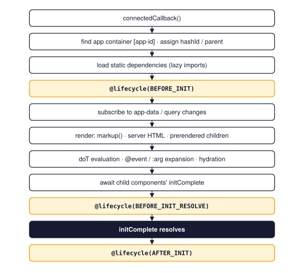

# Lifecycle hooks

Components and the application pass through well-defined stages. Methods decorated with
`@lifecycle(...)` run at those stages, in the spirit of Java's `@PostConstruct` and `@PreDestroy`.

```typescript
import { Lifecycle, lifecycle } from "joltui";

@lifecycle(Lifecycle.BEFORE_INIT)
async loadData(): Promise<void> {
    // runs before the first render
}
```

## The stages

| Stage | App | Component | When |
| --- | :-: | :-: | --- |
| `BEFORE_INIT` | ✓ | ✓ | Before rendering (component) / before the router is created (App). |
| `EXTENSION_INIT` | ✓ | | Right after the App's `BEFORE_INIT`. |
| `BEFORE_INIT_RESOLVE` | | ✓ | After rendering and after all child components have initialized, before `initComplete` resolves. |
| `AFTER_INIT` | ✓ | ✓ | After initialization has completed. |
| `BEFORE_RERENDER` | | ✓ | At the start of `rerender()`. |
| `AFTER_RERENDER` | | ✓ | After `rerender()` and its children have finished. |
| `AFTER_DISCONNECT` | | ✓ | After the element has been removed from the DOM. |

## A component's initialization

{ .diagram width="560" }

When a component is connected to the document, it:

1. locates the App and assigns its `hashId` and parent;
2. loads its [lazy dependencies](lazy-dependencies.md);
3. runs `BEFORE_INIT` hooks;
4. subscribes to data and query-parameter changes;
5. renders its markup and attaches event listeners;
6. waits until its direct child components have initialized;
7. runs `BEFORE_INIT_RESOLVE` hooks;
8. resolves `initComplete`;
9. runs `AFTER_INIT` hooks.

Each hook is awaited before the next step starts, and every step checks that the element is
still connected. If it has been removed, initialization stops quietly
([Cancellation](cancellation.md)).

## Typical uses

**`BEFORE_INIT`: load what the template needs.** The template is rendered right after this hook:

```typescript
@component({ tagName: "author-profile" })
export default class AuthorProfile extends CustomElement<MyApp> {
    private author: Author | null = null;

    @lifecycle(Lifecycle.BEFORE_INIT)
    async loadAuthor(): Promise<void> {
        const response = await fetch(`/api/authors/${this.args.id}`, {
            signal: this.abortSignal,
        });
        this.author = response.ok ? await response.json() : null;
    }

    override markup = () => html`
        <h2>{{! this.author?.name ?? "Unknown author" }}</h2>
        <p>{{! this.author?.bio ?? "" }}</p>
    `;
}
```

**`BEFORE_INIT_RESOLVE`: work that needs the finished subtree.** Child components have rendered,
but the parent's `initComplete` has not yet resolved, so anything waiting on the parent also
waits for this hook. Measure the DOM, set initial focus or initialise a third-party widget that
must be ready before the page counts as loaded.

**`AFTER_INIT`: start ongoing activity** such as timers, polling and analytics:

```typescript
private timer: number | undefined;

@lifecycle(Lifecycle.AFTER_INIT)
startClock(): void {
    this.timer = window.setInterval(() => this.invalidate("clock"), 1000);
}

@lifecycle(Lifecycle.AFTER_DISCONNECT)
stopClock(): void {
    window.clearInterval(this.timer);
}
```

**`AFTER_RERENDER`: restore what a full re-render destroyed**, for example re-initialising a
widget attached to elements that have just been replaced.

**`AFTER_DISCONNECT`: release resources.** The element's `abortSignal` has already been aborted
when this hook runs. Listeners registered with `{ signal: this.abortSignal }` are removed
automatically, so the hook is needed only for resources that do not understand abort signals:

```typescript
@lifecycle(Lifecycle.AFTER_INIT)
watchResize(): void {
    // removed automatically when the element is disconnected
    window.addEventListener("resize", () => this.invalidate("size"), {
        signal: this.abortSignal,
    });
}
```

## Rules

- `@lifecycle` decorates **methods**. It cannot decorate static, private (`#name`) or
  symbol-named methods, nor arrow-function properties.
- One method may subscribe to several stages:
  `@lifecycle(Lifecycle.AFTER_INIT, Lifecycle.AFTER_RERENDER)`.
- Several methods may subscribe to the same stage. They run one after another: base-class methods
  first, then subclass methods, each class in declaration order.
- **Overriding replaces registration.** If a subclass overrides a decorated method, only the
  subclass's version counts. An undecorated override removes the hook; decorators are not
  inherited by overrides.
- Hooks may be `async`; each is awaited before the next runs.

## Failures

An error thrown by a hook is wrapped in a `MethodExecutionError` that names the method and
component and keeps the original error as its `cause`.

- During **initialization stages** (`BEFORE_INIT`, `BEFORE_INIT_RESOLVE`), the failure is wrapped
  once more in an `ElementInitializationError`. `initComplete` rejects with it,
  `initializationState` becomes `"rejected"`, and the application's error handlers process it
  once, even when it also propagates through parent components.
- An **`AFTER_INIT`** failure is reported to the error handlers, but `initComplete` has already
  resolved and stays resolved.
- **Rerender** failures are reported to the error handlers, and the promise returned by
  `rerender()` rejects.

## Waiting for a component

```typescript
const card = this.querySelector<UserCard>("user-card");
await card?.initComplete;
```

For synchronous inspection, use `initializationState` (`"pending"`, `"fulfilled"` or
`"rejected"`) and `initializationError`.
