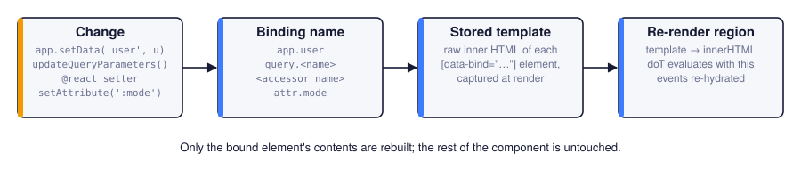

# Reactivity

JoltUI does not diff a virtual DOM. Templates declare which parts depend on which data, and when
that data changes JoltUI re-evaluates just those parts. This page covers the `data-bind`
mechanism and the three decorators built on it: `@react`, `@reactFactory` and `@queryParam`.

## Bound regions

Any element in a template can be marked with `data-bind="<binding name>"`. When the component
renders, JoltUI remembers the *raw template* of that element's contents. When the binding is
invalidated, it evaluates the stored template again and replaces the element's contents.

{ .diagram }

```typescript
override markup = () => html`
    <header>
        <h1>Inbox</h1>
        <span class="badge" data-bind="app.unread">
            {{= this.app.getData("unread") }}
        </span>
    </header>
    <message-list></message-list>
`;
```

Calling `app.setData("unread", 3)` anywhere in the application updates the badge and nothing
else. The header, the heading and `<message-list>` are not touched.

Several elements may use the same binding name; they all refresh together. Regions can be
nested: when the outer region refreshes, the inner one is rebuilt with it.

### Binding names

| Binding | Invalidated by |
| --- | --- |
| `app.<field>` | `app.setData("<field>", …)` |
| `query.<name>` | a change of query parameter `<name>` through the App |
| `attr.<name>` | changing attribute `data-jolt-<name>` (or `:<name>`) on the component's host element |
| any other name | a `@react` / `@reactFactory` property, or `this.invalidate(name)` |

### Rules for bound regions

A region is re-evaluated on its own, outside the context of the full template:

- **Reference only `this` and globals inside a region.** Loop variables (`{{~ list :item }}`) and
  variables declared in `{{ }}` code *outside* the region do not exist when the region is
  refreshed. Put the loop inside the region, not the region inside the loop.
- **Use `{{= }}` and `{{! }}`, not `${}`.** Template-literal values are fixed when `markup()`
  runs.
- **Write the attribute with double quotes:** `data-bind="app.user"`.
- **Keep template code out of table structure.** JoltUI stores a region's template by parsing it
  as HTML, and the HTML parser moves text that appears directly inside `<table>`, `<tbody>` or
  `<tr>` (such as a `{{~ }}` loop around rows) out of the table. The first render looks right;
  the refresh does not. Inside bound regions, build lists with `<ul>`/`<li>` or grid-styled
  `<div>` elements, or bind a region *inside* a table cell.
- **Child components inside a region are recreated** when it refreshes. Keep stateful children
  outside frequently changing regions.

Event handlers inside a region keep working: the refreshed contents are hydrated again.

## Application data: `app.<field>`

```typescript
override markup = () => html`
    <nav>
        <a href="/">Stories</a>
        <a href="/about">About</a>
        <div class="navbar-actions" data-bind="app.user">
            {{? this.app.getData("user") }}
                <a class="btn" href="/profile">Profile</a>
            {{??}}
                <a class="btn" href="/login">Sign in</a>
            {{?}}
        </div>
    </nav>
    <main id="page-content"></main>
`;
```

When the login page calls `this.app.setData("user", user)`, the navigation updates without the
layout or the page being re-rendered.

## Query parameters: `query.<name>`

Parameters changed with `app.updateQueryParameters()` or the `queryParameters` setter notify
bindings named after the parameter:

```typescript
override markup = () => html`
    <div class="filters">
        <button @click="setCategory" :category="All">All</button>
        <button @click="setCategory" :category="Design">Design</button>
    </div>

    <div data-bind="query.category">
        {{~ this.filteredPosts :post }}
            <article>{{! post.title }}</article>
        {{~}}
    </div>
`;

get filteredPosts(): Post[] {
    const category = this.app.queryParameters.category;
    return this.posts.filter(post => !category || post.category === category);
}

setCategory(_event: Event, args: { category: string }): void {
    this.app.updateQueryParameters({
        category: args.category === "All" ? null : args.category,
    });
}
```

The URL changes (`?category=Design`) and the list refreshes. Because the state is in the URL, it
survives a reload and works with the Back button.

## Attributes: `attr.<name>`

A component can bind markup to its own host attributes. Whenever `data-jolt-<name>` changes on
the host, regions bound to `attr.<name>` refresh:

```typescript
@component({ tagName: "status-dot" })
export default class StatusDot extends CustomElement<MyApp> {
    override markup = () => html`
        <span data-bind="attr.status">
            <i class="dot dot-{{= this.args.status }}"></i> {{= this.args.status }}
        </span>
    `;
}
```

```typescript
const dot = this.querySelector("status-dot");
dot?.setAttribute(":status", "offline");   // refreshes the region
dot?.toggleAttribute(":status");           // removal also counts
```

`setAttribute`, `removeAttribute` and `toggleAttribute` all trigger the refresh, but only when the
value actually changes. Only the *contents* of the bound element are re-evaluated, not its own
attributes; put dynamic classes on an inner element.

## Component state: `@react`

`@react(initialValue, bindingName?)` turns an `accessor` field into reactive state. Assigning a
new value invalidates the binding, which by default has the property's name:

```typescript
import { react } from "joltui";

@component({ tagName: "todo-list" })
export default class TodoList extends CustomElement<MyApp> {
    @react([] as string[])
    accessor items!: string[];

    @react("")
    accessor draft!: string;

    override markup = () => html`
        <form @submit="add">
            <input name="item" @input="typing" placeholder="New item">
            <button>Add</button>
        </form>
        <p data-bind="draft">Typing: {{! this.draft }}</p>
        <ul data-bind="items">
            {{~ this.items :item }}<li>{{! item }}</li>{{~}}
        </ul>
    `;

    typing(event: Event): void {
        this.draft = (event.target as HTMLInputElement).value;
    }

    add(event: Event): void {
        event.preventDefault();
        if (!this.draft) return;
        this.items = [...this.items, this.draft];
        (event.currentTarget as HTMLFormElement).reset();
        this.draft = "";
    }
}
```

- **Each instance gets its own copy** of the initial value, cloned with `structuredClone`, so
  `@react([])` does not share one array between instances.
- **Assignment triggers, mutation does not.** The setter compares values with `Object.is`.
  `this.items.push(x)` notifies nobody; write `this.items = [...this.items, x]`, or call
  `this.invalidate("items")` after the mutation.
- **Custom binding names** let one property drive a differently named region, or several
  properties share one: `@react(0, "totals")`.
- The `accessor` keyword is required. It is part of the standard decorators proposal and lets the
  decorator intercept reads and writes.

## Non-cloneable initial values: `@reactFactory`

`structuredClone` cannot copy functions, class instances with private state or DOM nodes. For
such values, supply a factory that produces a fresh value for every instance:

```typescript
import { reactFactory } from "joltui";

@reactFactory(() => new Map<number, Post>())
accessor postCache!: Map<number, Post>;

@reactFactory(() => new ShoppingCart(), "cart")
accessor cart!: ShoppingCart;
```

## Manual invalidation

`this.invalidate(name)` refreshes every region bound to `name` in this component. Use it for state
that is not held in a decorated property:

```typescript
private readonly selected = new Set<number>();

toggle(_event: Event, args: { id: number }): void {
    if (!this.selected.delete(args.id)) this.selected.add(args.id);
    this.invalidate("selection");
}
```

## Query parameters as properties: `@queryParam`

`@queryParam(name, defaultValue?, bindingName?)` exposes a query parameter as a string property.
Reading it returns the current value (or the default); writing it calls
`app.updateQueryParameters()`:

```typescript
import { queryParam } from "joltui";

@page({ path: "/search", title: "Search" })
@component({ tagName: "search-page" })
export default class SearchPage extends CustomElement<MyApp> {
    @queryParam("q", "", "query.q")
    accessor q!: string;

    @queryParam("page", "1", "query.page")
    accessor page!: string;

    override markup = () => html`
        <input value="{{! this.q }}" @change="search">
        <div data-bind="query.q">Results for "{{! this.q }}"</div>
        <nav data-bind="query.page">
            Page {{= this.page }}
            <button @click="next">Next</button>
        </nav>
    `;

    search(event: Event): void {
        this.q = (event.target as HTMLInputElement).value;
        this.page = "1";
    }

    next(): void {
        this.page = String(Number(this.page) + 1);
    }
}
```

Setting the property to `null` removes the parameter (declare the property as `string | null`
and omit the default to allow that).

!!! tip "Which binding name?"

    Writing the property already fires the `query.<name>` event through the App. If you omit the
    third argument, the decorator additionally invalidates a local binding called `query-<name>`.
    Passing `"query.<name>"` as the binding name, as above, avoids the second refresh and keeps
    one consistent name for every region that depends on the parameter.

## Choosing a tool

| Situation | Tool |
| --- | --- |
| State shared by several components | application data + `app.<field>` bindings |
| State that belongs in the URL (filters, paging, tabs) | `@queryParam` or `updateQueryParameters` + `query.<name>` |
| State local to one component | `@react` / `@reactFactory` |
| A parent configuring a child at runtime | host attributes + `attr.<name>` |
| One component telling another to act | a [direct method call](communication.md) |
| Anything else | a plain field + `invalidate(name)` |
| The whole component depends on one data field | `dataField` in `@component` |
